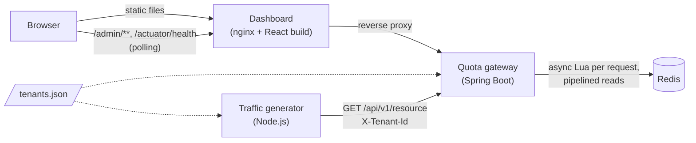
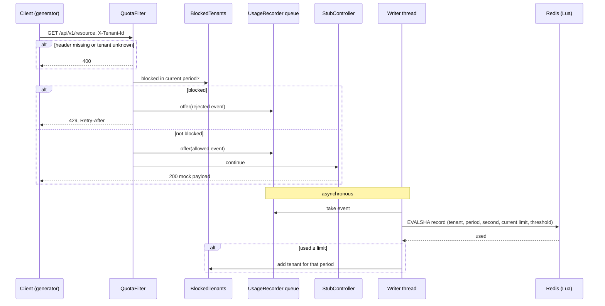

# Architecture: Tiered Tenant Quota Prototype

Requirements: [requirements.md](requirements.md). Plan: [backlog.md](backlog.md).

## 1. Overview



Four containers in docker compose: **Redis**, **gateway**, **dashboard**, **generator**. `tenants.json` is mounted into the gateway and the generator.

## 2. Components

### 2.1 Quota gateway (Java 21, Spring Boot, Spring MVC)

A standalone gateway whose upstream is a stub. It also hosts the admin API (prototype simplification).

| Part | Responsibility |
|---|---|
| `QuotaFilter` | Servlet filter on `/api/**`. Reads `X-Tenant-Id`, checks `BlockedTenants`, returns 400 / 429 or passes the request on, and hands an allowed/rejected event to `UsageRecorder`. No I/O. |
| `BlockedTenants` | In-memory set of tenants over limit, tied to one period index and replaced with an empty set when the period changes. Tier changes remove the tenant from it. |
| `UsageRecorder` | Bounded queue plus one writer thread. Applies each event to Redis with the record Lua script and adds the tenant to `BlockedTenants` when the returned `used` reaches its current limit. Drops events when the queue is full and counts the drops; logs Redis failures. |
| `StubController` | Returns the mock payload for `GET /api/v1/resource`. The single replacement point for a real upstream proxy. |
| `TenantRegistry` | `ConcurrentHashMap` seeded from `tenants.json`. Lookup by id, filtering by name, id and tier, sorted by name, tier update. |
| `TierConfig` | Tier limits, period length, near threshold from `application.yml`. |
| `QuotaPeriod` | Computes the period index and seconds to the next boundary from an injectable `Clock`. |
| `MetricsSnapshotJob` | Runs every second, reads global metrics from Redis in one pipelined round trip, caches the result in memory. |
| `AdminController` | `GET /admin/snapshot?name=&id=&tier=&status=&page=&size=`, `GET /admin/tiers`, `PUT /admin/tenants/{id}/tier`. |
| Actuator health | `/actuator/health` with the built-in Redis health indicator and a short Redis command timeout. |

### 2.2 Redis

Holds all counters and the near/over sets. No tenant data, no tier data. Every key is scoped to a period or a second and expires on its own, so there are no reset or cleanup jobs.

### 2.3 Admin dashboard (React + TypeScript, Vite)

- Built to static files and served by an **nginx** container, which also reverse-proxies `/admin/**` and `/actuator/health` to the gateway. The browser talks to one origin, so no CORS configuration is needed.
- A small `usePolling` hook (interval, timeout, no overlap, consecutive-failure count) drives both the snapshot and the health poll.
- Plain React state and hooks; no state management or UI library. The 60-second trend is a hand-written SVG sparkline.

### 2.4 Traffic generator (Node.js LTS, TypeScript)

- A single TypeScript script run directly by Node (type stripping, no build step). Uses built-in `fetch` with keep-alive.
- Paces requests to a total rate and picks the tenant by weighted random choice. Weights come from its own config; tenants come from `tenants.json`.
- Never crashes on gateway errors; logs a summary every 10 s.

## 3. Communication

| From | To | Protocol | Purpose |
|---|---|---|---|
| Generator | Gateway | HTTP `GET /api/v1/resource` + `X-Tenant-Id` | Business traffic |
| Browser | Dashboard nginx | HTTP | Static app |
| Browser → nginx | Gateway | HTTP polling: `/admin/snapshot` every 1 s, `/actuator/health` every 5 s | Live data, health |
| Browser → nginx | Gateway | HTTP `PUT /admin/tenants/{id}/tier` | Tier change |
| Gateway (writer thread) | Redis | RESP: one asynchronous `EVALSHA` per business request, off the request path. Gateway (snapshot):  one pipeline per second for global metrics; per snapshot request one `MGET` for rows, plus `SMEMBERS` when filtering by status | Counting, metrics |

## 4. Redis data model

`p` = period index = `floor(epochSeconds / periodSeconds)`. `s` = epoch second.

| Key | Type | Written by | Read by | TTL |
|---|---|---|---|---|
| `quota:used:{tenantId}:{p}` | counter | Lua, allowed events | Lua (returned to the writer); snapshot rows | 2 periods |
| `quota:rejected:{tenantId}:{p}` | counter | Lua, rejected events | Snapshot rows | 2 periods |
| `quota:near:{p}` | set of tenant ids | Lua | `SCARD` in snapshot job; `SMEMBERS` for the status filter | 2 periods |
| `quota:over:{p}` | set of tenant ids | Lua | `SCARD` in snapshot job; `SMEMBERS` for the status filter | 2 periods |
| `traffic:allowed:{s}` / `traffic:rejected:{s}` | counter | Lua | Snapshot job (`MGET` of 60 + 60) | 120 s |
| `traffic:total:allowed:{p}` / `traffic:total:rejected:{p}` | counter | Lua | Snapshot job | 2 periods |

## 5. Request flow

The quota decision never touches Redis. Recording happens on a separate thread, one Redis call per request.



The Lua script, in one atomic step per event:

1. **Allowed event:** increment `used`, `traffic:allowed:{s}`, `traffic:total:allowed:{p}`. **Rejected event:** increment `rejected`, `traffic:rejected:{s}`, `traffic:total:rejected:{p}`. There is no check: the decision was already made in memory.
2. Recompute the tenant's status against the limit passed in (the tenant's **current** limit) and fix set membership: over → add to `over`, remove from `near`; near → add to `near`, remove from `over`; ok → remove from both.
3. Set TTLs on keys it creates. Return `used`.

The event carries the period and second captured when the request arrived, so an event processed just after a boundary is counted in the right period. The writer only adds a tenant to the blocked set if the event's period is still the current one.

**Overshoot.** Between the request that crosses the limit and the Redis response, more requests for that tenant pass: roughly `tenant's request rate × recording delay` (queue wait + one round trip). With several gateway instances, each blocks the tenant on its own next response, because the Redis count is global, so the same bound applies per instance.

**Redis failure.** Recording calls fail or the queue fills and events are dropped; failures are logged. The request path is unchanged: the blocked set keeps rejecting tenants already in it until the period ends, and no new tenants get blocked.

## 6. Snapshot flow

- **Global part, once per second** (`MetricsSnapshotJob`): one pipeline with `MGET` of the last 60 complete seconds of allowed and rejected buckets, `GET` of the two period totals, `SCARD` of the near and over sets. The result is cached together with its timestamp. On a Redis error the cache is marked unavailable.
- **Rows, per request:**
  1. `TenantRegistry` applies the name, id and tier filters and sorts by name.
  2. With a status filter, the gateway reads the current period's set with `SMEMBERS` (near or over) and intersects; for "ok" it removes members of both sets.
  3. It counts the total, cuts the requested page (offset = page × size), and one `MGET` reads `used` and `rejected` for that page (20 keys for size 10). Status is computed against each tenant's current limit.
- The response always contains the rows from the registry for name, id and tier filters. Metric parts are `null` when Redis can't be read, so the dashboard can show "Metrics unavailable" and still allow tier changes. A status-filtered request can't be answered without Redis, so its rows are marked unavailable.

## 7. Key decisions

| # | Decision | Why | Production direction |
|---|---|---|---|
| D1 | Standalone gateway with a stubbed upstream | Keeps the gateway shape without proxying work that shows nothing about quotas | Replace `StubController` with a proxy route (e.g. Spring Cloud Gateway Server MVC) |
| D2 | Admin API inside the gateway | The registry is in gateway memory, so tier changes apply instantly with no sync | Separate admin service; registry in a database, changes pushed to gateways (e.g. pub/sub) |
| D3 | Tenant arrives resolved in `X-Tenant-Id` | Authentication belongs to the layer in front | Identity from an auth layer or gateway plugin |
| D4 | Fixed window aligned to UTC epoch, configurable length | Matches "reset at midnight"; resets happen through key naming, with no jobs | Period = 1 day |
| D5 | Quota decision in memory against a per-instance blocked set; usage recorded asynchronously, one Lua call per request; only allowed requests consume | Near-zero decision cost and Redis off the request path; a few requests of overshoot are acceptable for a commercial limit | Same; per-event writes keep multi-node behavior simple |
| D6 | On Redis failure, keep working with the in-memory blocked set | Quota is a commercial limit, not a security boundary; a counter outage must not become an API outage | Same, with alerting on degraded enforcement |
| D7 | Counting only in Redis; memory holds just the blocked set | The Redis count is global, so every instance learns a tenant is over limit from its own next response | Same |
| D7a | Bounded event queue, drop on overflow | Request threads never block and memory can't grow during a Redis outage; counts are lost in an outage anyway | Same, with a dropped-events metric and alert |
| D8 | Cached global snapshot + one page of rows; near/over as sets maintained on write and reused for the status filter | Snapshot cost independent of tenant count and number of viewers; filtering by status needs no tenant scan in Redis | Same; sorted sets for top-N by usage |
| D9 | Polling instead of SSE | Simplest delivery that meets the 1 s freshness target | SSE push from a dedicated admin service |
| D10 | Health separate from the snapshot | The snapshot describes business data; infrastructure health is a separate concern | Redis monitored separately; gateway probes must **not** depend on Redis |
| D11 | Tier changes only in memory | No database in the prototype | Persisted in the admin service's database |
| D12 | Node.js generator | Light, no build step, no new toolchain (Node is already in the repo via Vite) | Replaced by real clients; a load tool for performance tests |
| D13 | nginx serves the dashboard and proxies the admin API | One origin, no CORS | Behind the company's ingress |

## 8. Production considerations

- **Scale.** At about 4,200 req/s, recording is about 4,200 Lua calls per second off the request path, which a single Redis instance handles comfortably. If Redis load or writer throughput ever becomes a limit, the writer can batch and aggregate deltas per tenant, at the cost of a larger overshoot.
- **Restart.** A restarted instance starts with an empty blocked set, so each blocked tenant gets a few extra requests until its next response. If that matters, the instance can load `quota:over:{p}` on startup.
- **Tier changes across instances.** With a separate admin service, every gateway instance must learn about the change (e.g. pub/sub) to update its registry and drop the tenant from its blocked set.
- **Redis Cluster.** A Lua script may only touch keys in one hash slot. The current script mixes per-tenant keys with global keys, so in a cluster it would be split: per-tenant keys share a hash tag `{tenantId}`, and global counters are updated separately.
- **Hot global keys.** Global counters receive every request. At production rate they should be sharded (N sub-counters summed on read) or aggregated per gateway instance and flushed every second.
- **Clock skew.** Each instance computes the period from its own clock when a request arrives, so instances with skewed clocks switch periods at slightly different moments. With NTP-synced hosts that's milliseconds and is accepted.
- **Health.** Redis has its own monitoring and alerts. The gateway's liveness and readiness probes check only the gateway; enforcement status is reported as a separate metric.
- **Dashboard at 50,000 tenants.** Name and tier filtering would move to an index (database or search service) instead of scanning the registry, with cursor-based rather than offset pagination. The over/near sets can hold thousands of ids, so the status filter would read them with `SSCAN` or keep them in the search index. Top-N views would use sorted sets.

## 9. Technology

| Area | Choice |
|---|---|
| Gateway | Java 21, Spring Boot (Spring MVC, Actuator, Spring Data Redis / Lettuce), Gradle Kotlin DSL |
| Counters | Redis, Lua scripts |
| Dashboard | React, TypeScript, Vite; served by nginx |
| Generator | Node.js LTS, TypeScript (run directly) |
| Tests | JUnit 5 + Testcontainers; Vitest + React Testing Library; Vitest for the generator |
| Runtime | Docker, docker compose, start/stop scripts in `/scripts` |

## 10. Repository layout

```
/gateway             Spring Boot app (Gradle Kotlin DSL)
/dashboard           React + Vite app, nginx config, Dockerfile
/generator           Node.js script, config, Dockerfile
/config/tenants.json
/scripts             start and stop the whole stack or individual components
                     (redis, gateway, dashboard, generator), e.g. to demo a Redis
                     or gateway outage
/docs                task.md, requirements.md, architecture.md, backlog.md
/openspec            specs and changes
docker-compose.yml
```
